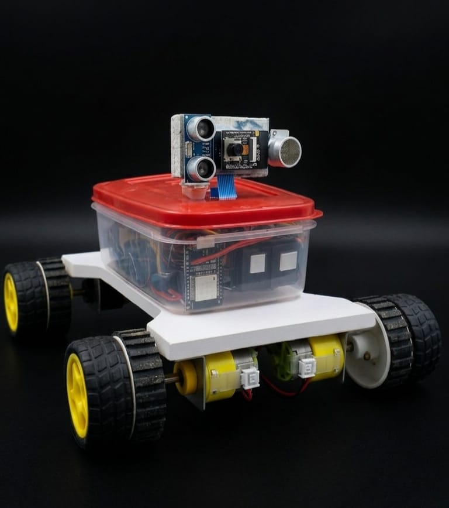

<p align="center">
  
</p>

<h1 align="center">MineX — Intelligent Mine Rescue Rover</h1>

<p align="center">
  <strong>AI-Powered Autonomous Rover for Underground Mine Safety & Rescue Operations</strong>
</p>

<p align="center">
  <a href="#overview">Overview</a> ·
  <a href="#key-features">Features</a> ·
  <a href="#system-architecture">Architecture</a> ·
  <a href="#hardware">Hardware</a> ·
  <a href="#team">Team</a> ·
  <a href="#license">License</a>
</p>

---

## Overview

**MineX** is a next-generation mine rescue rover system designed for the **Smart India Hackathon 2026**. It combines edge-AI vision, real-time environmental sensing, and a professional command center dashboard to enable safe, remote exploration of hazardous underground mine environments.

The system is purpose-built to detect trapped miners, identify toxic gas zones, and map collapsed tunnel structures — all without putting human operators at risk.

## Key Features

| Feature | Description |
|---|---|
| **AI Vision (YOLOv8)** | Real-time object detection via ESP32-CAM for human detection and hazard identification |
| **Environmental Sensing** | Continuous temperature, humidity (DHT11) and toxic gas monitoring (MQ-135) |
| **Motion & Orientation** | 6-axis IMU (MPU-6050) + digital compass (QMC5310) for heading and tilt tracking |
| **Command Center** | Professional web dashboard with live telemetry, camera feeds, and rover controls |
| **Session Logging** | Timestamped telemetry recording for post-mission analysis and reporting |
| **Fault-Tolerant Design** | Multi-threaded architecture with automatic sensor thread recovery |

## System Architecture

```
┌──────────────────────────────────────────────────────────┐
│                    COMMAND CENTER (Web)                   │
│  ┌────────────┐ ┌────────────┐ ┌────────────────────┐   │
│  │  Live Feed  │ │ Telemetry  │ │   Rover Controls   │   │
│  │  (MJPEG)   │ │  Charts    │ │  (Manual / Auto)   │   │
│  └────────────┘ └────────────┘ └────────────────────┘   │
└──────────────────────┬───────────────────────────────────┘
                       │ HTTP / WebSocket
┌──────────────────────┴───────────────────────────────────┐
│                   ROVER (ESP32 + Pi)                     │
│  ┌──────────┐ ┌──────────┐ ┌──────────┐ ┌────────────┐ │
│  │ ESP32-CAM │ │  DHT11   │ │  MQ-135  │ │ MPU-6050 + │ │
│  │ (Vision) │ │ (Env)    │ │ (Gas)    │ │ QMC5310    │ │
│  └──────────┘ └──────────┘ └──────────┘ └────────────┘ │
│  ┌──────────────────────────────────────────────────┐   │
│  │          Motor Driver (L298N) — 4WD Drive        │   │
│  └──────────────────────────────────────────────────┘   │
└──────────────────────────────────────────────────────────┘
```

## Hardware

| Component | Purpose |
|---|---|
| **ESP32** | Main microcontroller, Wi-Fi AP, sensor hub |
| **ESP32-CAM** | Live MJPEG video stream + YOLOv8 inference input |
| **DHT11** | Temperature & humidity monitoring |
| **MQ-135** | Air quality / toxic gas detection |
| **MPU-6050** | 6-axis accelerometer + gyroscope (pitch, roll) |
| **QMC5310** | Digital compass for heading |
| **L298N** | Dual H-bridge motor driver for 4WD |
| **Servo Motor** | Camera pan control |

## Tech Stack

| Layer | Technology |
|---|---|
| **Frontend** | Next.js 15, React 19, TypeScript |
| **Styling** | Tailwind CSS 4 |
| **Animations** | Framer Motion |
| **Charts** | Recharts |
| **Icons** | Lucide React |
| **Firmware** | MicroPython / Arduino (ESP32) |

## Dashboard Preview

The MineX Command Center provides:

- **Live Camera Feed** — MJPEG stream from ESP32-CAM
- **Safety Intel Panel** — Real-time environmental sensor readings with threshold alerts
- **Rover Control** — D-pad controls, camera pan slider, and headlight toggle
- **Telemetry Charts** — Scrolling graphs for temperature, humidity, gas levels, and heading
- **Session Logging** — Start/stop recording sessions with timestamped data
- **Alert Center** — Real-time hazard detection notifications

## Project Structure

```
SIH2026-MineX/
├── minex/                    # Next.js web application
│   ├── app/                  # Pages & routes
│   │   ├── dashboard/        # Command center dashboard
│   │   └── api/              # Backend API routes
│   ├── components/           # React components
│   │   ├── dashboard/        # Dashboard panels & controls
│   │   ├── landing/          # Homepage sections
│   │   └── navigation/       # Nav bar & footer
│   ├── lib/                  # Utilities & constants
│   └── public/               # Static assets
├── .gitignore
├── LICENSE
└── README.md
```

## Team.

Built for **Smart India Hackathon 2026** by Team MineX.

## License

This project is licensed under the MIT License — see the [LICENSE](LICENSE) file for details.
